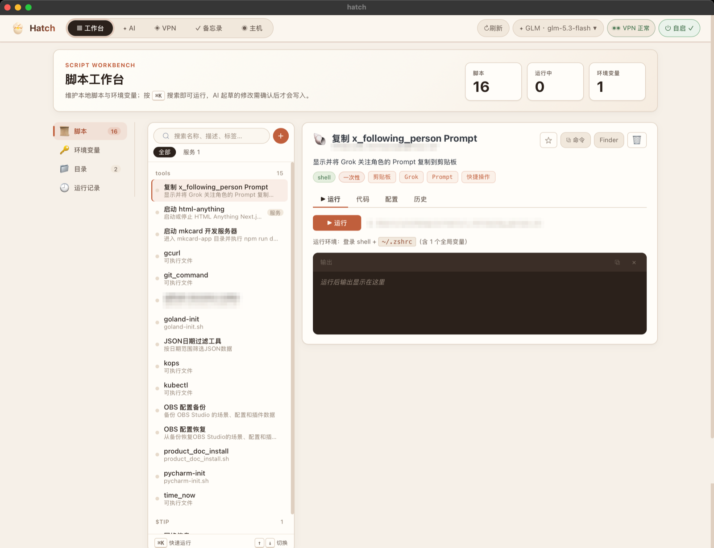
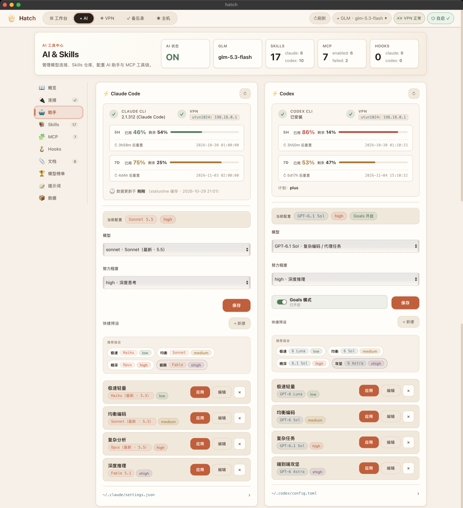
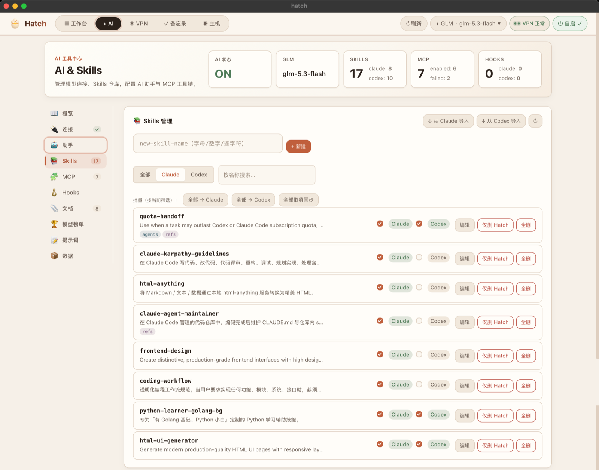
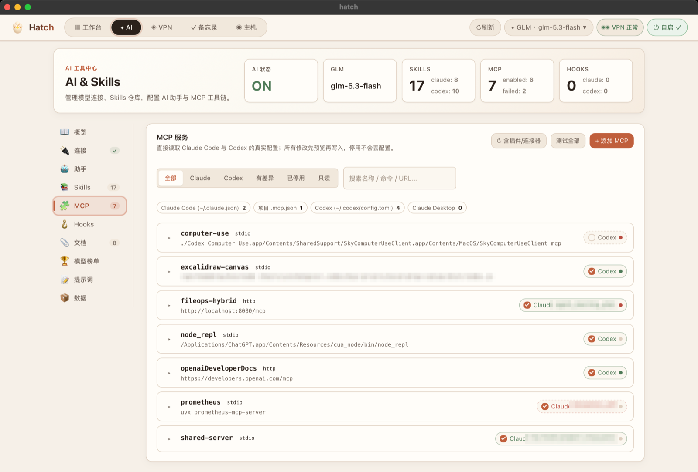
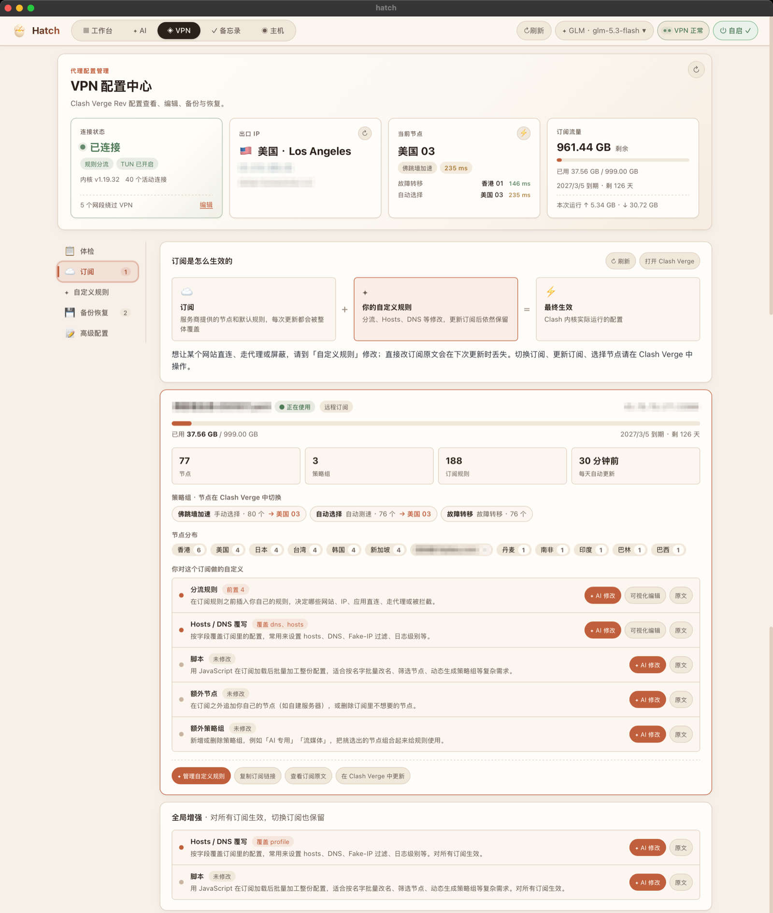
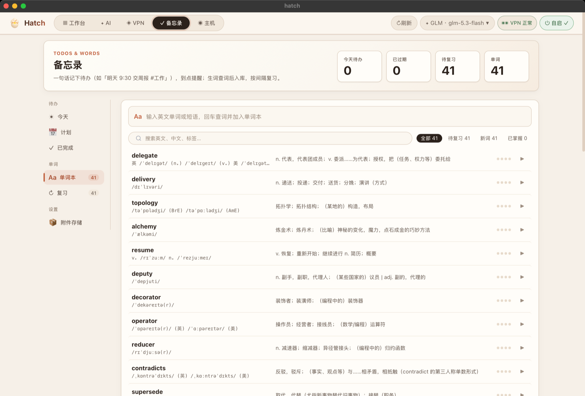

<div align="center">


# Hatch

**macOS 脚本管理与开发环境仪表盘**


</div>

Hatch 是一个面向 Apple Silicon macOS 的本地桌面工具，把脚本管理、AI 编码助手配置、VPN（Clash Verge Rev）维护、日常备忘和主机监控集中在一个窗口里。
在 App Store 之外分发，**不需要 Apple 开发者账号**，所有数据都保存在本机。

<p align="center">
  
</p>

## 界面一览

<table>
  <tr>
    <td width="50%" valign="top"><b>🗂 工作台</b> · 脚本、服务、⌘K 快速运行<br /></td>
    <td width="50%" valign="top"><b>✦ 助手</b> · Claude Code / Codex 用量与模型配置<br /></td>
  </tr>
  <tr>
    <td width="50%" valign="top"><b>✦ Skills</b> · 主仓库与双端同步<br /></td>
    <td width="50%" valign="top"><b>✦ MCP</b> · 直接读写 Claude Code / Codex 配置<br /></td>
  </tr>
  <tr>
    <td width="50%" valign="top"><b>✦ 模型榜单</b> · 各领域 Top 4 推荐<br /></td>
    <td width="50%" valign="top"><b>🔒 VPN · 订阅</b> · 订阅与增强一目了然<br /></td>
  </tr>
  <tr>
    <td width="50%" valign="top"><b>🔒 VPN · 自定义规则</b> · 保存即热加载<br /></td>
    <td width="50%" valign="top"><b>◉ 主机</b> · 实时监控与磁盘 / 网络测速<br /></td>
  </tr>
  <tr>
    <td colspan="2" align="center"><b>✓ 备忘录</b> · 待办提醒、单词本与间隔复习<br /></td>
  </tr>
</table>

<sub>截图中的出口 IP、订阅名、本机路径等敏感信息已做马赛克处理。</sub>

---

## 功能模块

顶部五个模块均可在配置文件中单独开关（见 [模块开关](#模块开关)）。

| 模块 | 主要能力 |
|---|---|
| 🗂 **工作台** | 按目录管理脚本：自动扫描与 `@hatch.*` 注解识别、一次性脚本 / 常驻服务（start/stop/restart）、实时日志与运行历史（可只看失败）、定时任务、前置脚本链、单脚本环境变量与 `.env` 粘贴导入、完成通知；`⌘K` 快速搜索并运行脚本 / 预设；`~/.zshrc` export 托管块、zshrc 解析 / 备注 / AI 整理；PATH 与依赖体检；内置脚本编辑器，AI 起草 / 修改以 diff 呈现，确认后才写入 |
| ✦ **AI** | 概览仪表盘；OpenAI 兼容 provider 管理与调用日志；Claude Code / Codex 模型与推理档位配置、推荐组合、预设，用量状态含 5H / 7D 额度与重置时间（北京时间）；**模型榜单**：Arena / Epoch AI 公开数据，按编程 / 图像 / 前端 / 综合给出 Top 4 推荐；Skills 主仓库与双端同步，导入时可确认同名冲突，支持批量同步；**MCP**：直接读写 Claude Code / Codex 的配置，写入前预览，支持连接测试与 AI 选型推荐；命令型 Hooks 双端同步与模板库；本地文档快捷入口；提示词覆盖；数据目录、保留策略与备份恢复 |
| 🔒 **VPN** | Clash Verge Rev 连接状态 / TUN、出口 IP、当前节点与延迟、订阅流量；一键体检；订阅与增强文件查看，AI 修改在写入前先验证效果；**自定义规则**可视化编辑（分流 / Hosts / Fake-IP / DNS / TUN 绕过），保存即热加载；配置备份 / 预览 / 恢复；原始配置文件编辑（保存前 YAML 校验并自动备份） |
| ✓ **备忘录** | 一句话添加待办（自动识别「明天 9:30」「下周三」`#标签` `!高` 等），今天 / 计划 / 已完成视图；提醒（横幅 / 声音）、图片与文件附件托管；单词本：词典查询、发音、AI 补全、间隔复习 |
| ◉ **主机** | 处理器、内存、磁盘、温度与风扇的实时监控；磁盘读写测速与目录占用分析；按网卡的实时流量、网络测速与监听端口；设备详情 |

所有 AI 能力只生成草稿供确认，不会自动写入配置、脚本或 zshrc。

---

## 快速开始

### 环境要求

- Apple Silicon Mac（`darwin/arm64`）
- Go 1.23+
- Node.js + npm（前端构建）
- Wails CLI v2：`go install github.com/wailsapp/wails/v2/cmd/wails@v2.12.0`
- 可选：`create-dmg`（`brew install create-dmg`，仅打 DMG 时需要）

### 编译并安装

```bash
make build      # 编译打包 → build/bin/Hatch.app
make install    # 复制到 /Applications 并清除隔离属性
```

> **覆盖安装注意**：`make install` 使用 `cp -r`，若 `/Applications/Hatch.app` 已存在，新包会被复制到旧包内部而不是覆盖。重新安装前请先退出并删除旧版本：
>
> ```bash
> osascript -e 'quit app "Hatch"'
> rm -rf /Applications/Hatch.app
> make build && make install
> ```

只想本地运行、不安装：`make open`。

---

## 模块开关

配置文件 `~/Library/Application Support/Hatch/config.json` 中的 `modules` 控制顶部模块是否显示：

```json
{
  "modules": {
    "workbench": true,
    "ai": true,
    "vpn": false,
    "memo": true,
    "host": true
  }
}
```

| 键 | 模块 |
|---|---|
| `workbench` | 🗂 工作台 |
| `ai` | ✦ AI（同时隐藏右上角「✦ AI」快捷面板） |
| `vpn` | 🔒 VPN（同时隐藏右上角 VPN 状态按钮） |
| `memo` | ✓ 备忘录 |
| `host` | ◉ 主机 |

- 未写 `modules` 或缺少某个键时，该模块默认**显示**；新版 Hatch 第一次保存设置时会自动写入五个 `true`。
- 修改后**无需重启**：点击顶部「↻ 刷新」或切回 Hatch 窗口即生效；当前模块被隐藏时自动切到其他可见模块。
- 全部关闭时会保留工作台，窗口不会为空。
- Hatch 自身保存配置时不会覆盖你手动改的 `modules`。
- 隐藏只影响界面：定时任务、备忘提醒、数据清理等后台功能照常运行。

> `config.json` 中以明文保存 AI API Key 和 MCP 环境变量，请勿外传。

---

## 开发

```bash
make dev          # cd src && wails dev，热更新开发模式（自动打开窗口）
make test         # cd src && go test ./... -v
make test-short   # 只显示 PASS / FAIL
```

- 开发服务器同时运行在 http://localhost:34115，可在浏览器 devtools 中通过 `window.go.app.App.<Method>()` 调用 Go 方法。
- 新克隆的仓库需要先构建一次前端（`make build` 或 `cd frontend && npm run build`），生成 `src/web/dist` 后 `go test` / `go vet` 才能编译通过（该目录会被嵌入二进制）。
- `frontend/wailsjs/**` 由 Wails 在 `wails dev` / `wails build` 时自动生成，请勿手动编辑。

### 架构约定

- **前后端分离**：`frontend/` 是独立的 Vite 工程；`src/` 是 Go module（`module hatch`）与 Wails 工程目录。所有 Go / Wails 命令都在 `src/` 下执行（Makefile 已内置 `cd src`）。
- **后端分层**：`src/app` 是唯一绑定到前端的包（JS 中为 `window.go.app.App`），按界面模块拆分文件，只负责加锁、保存配置、发送事件；具体逻辑放在对应的模块包（`core` / `workbench` / `ai` / `vpn` / `memo`）。模块包不依赖 Wails 和 `app`，`core` 不依赖任何业务模块。
- **前端约定**：Alpine.js v3 + Pico CSS v2，不使用 Tailwind；`main.js` 先 import Pico 再 import `./style.css`；新功能不写内联 `style`，使用 `style.css` 中的具名 class。

---

## 打包发布

目标平台固定为 **Apple Silicon macOS（`darwin/arm64`）**，由根目录 `Makefile` 驱动：

| 命令 | 作用 |
|---|---|
| `make build` | `cd src && wails build -platform darwin/arm64`，增量编译 → `build/bin/Hatch.app` |
| `make build-clean` | 加 `-clean` 完整重新编译 |
| `make sign` | 对 `Hatch.app` 做 **ad-hoc 自签名**（`codesign --sign -`，无需开发者证书） |
| `make dmg` | 用 `create-dmg` 打成 `build/bin/Hatch-<version>-arm64.dmg`（依赖 `sign`） |
| `make release` | 完整发布链：`build-clean → sign → dmg` |
| `make install` | 复制到 `/Applications` 并 `xattr -cr` 清除隔离属性 |
| `make open` | `xattr -cr` 后直接运行，绕过 Gatekeeper |

也可以使用 `./scripts/release.sh <version>` 一次完成构建、签名和 DMG 打包。

### 发布要点

- **签名策略**：ad-hoc 自签名，用户首次运行需清除 quarantine 属性（`make install` / `make open` 已内置 `xattr -cr`）。
- **分发物**：单个 `.dmg`，拖入 `/Applications` 即可。
- **版本号**：`Makefile` 的 `VERSION` 与 `src/wails.json` 的 `productVersion` 需要保持一致：

  ```bash
  make release VERSION=2.2.2   # 同时更新 src/wails.json 中的 productVersion
  ```

---

## 🤝 参与贡献

欢迎提交 Issue 和 Pull Request。

- 后端逻辑放在对应的模块包（`core` / `workbench` / `ai` / `vpn` / `memo` / `hostmonitor`），`src/app` 只做 Wails 绑定；模块包不依赖 Wails 和 `app`。
- 前端使用 Alpine.js + Pico CSS，不引入 Tailwind，新样式写进 `frontend/src/style.css` 的具名 class，避免内联 `style`。
- 提交前请运行 `make test`，涉及界面的改动请附一张截图。
- AI 相关功能只生成草稿供用户确认，不要静默写入配置、脚本或 zshrc。

## 📝 License

MIT License，详见 [LICENSE](LICENSE)。
